<!-- ============================================================
     0xAYUSHM // PROFILE.SYS
     All animated panels in /assets are hand-built SVGs (no JS).
     ============================================================ -->

  

  
  
  
  
  

 

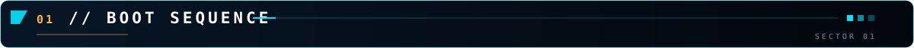

  

 

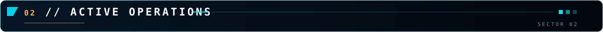

  

 

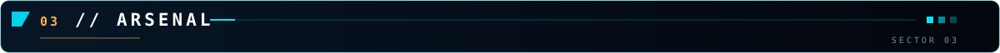

   
  

 

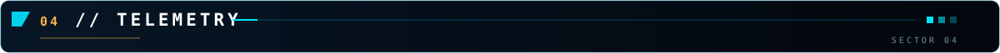

  

  <picture>
    <source media="(prefers-color-scheme: dark)" srcset="https://raw.githubusercontent.com/0xayushM/0xayushM/output/hud-snake.svg"/>
    <source media="(prefers-color-scheme: light)" srcset="https://raw.githubusercontent.com/0xayushM/0xayushM/output/github-snake.svg"/>
    
  </picture>

 

  

 

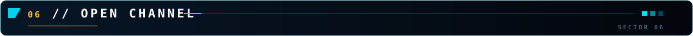

  <code>&gt; open to: creative builds · motion &amp; 3D web · AI systems · design collabs</code> 
  <code>&gt; ping: <a href="https://ayushmangal.com">ayushmangal.com</a></code>

  

